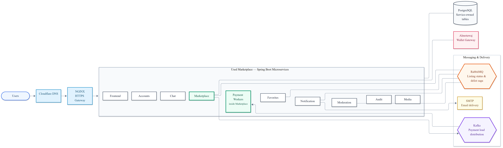

# Used Marketplace

Used Marketplace is a production-deployed second-hand marketplace for Bahrain.
Verified members can publish listings with real photos, search across multiple
categories, save items, chat with sellers, report unsafe content, and buy using
an internal wallet, Almotawaj Wallet, or cash on delivery. Administrators manage
users, listings, reports, and wallet funding from a separate portal.

**Live application:** [https://used.thrifty.bid](https://used.thrifty.bid)



## Main features

- Email verification, password recovery, HttpOnly JWT sessions, and CSRF protection.
- Public listing discovery with keyword and one-to-five-category filtering.
- Mobile-friendly listing and profile image uploads through the Media service.
- Favorites, seller chat, persisted notifications, SSE updates, and email delivery.
- Internal-wallet payments distributed through Kafka, with atomic listing sale,
  wallet transfer, payment, and transaction records inside Marketplace.
- Almotawaj Wallet checkout with signed callbacks and idempotent completion.
- Seller-managed cash-on-delivery requests.
- Administrator user management, wallet funding, listing management, and a
  RabbitMQ-backed moderation delisting saga.
- Jenkins build, test, deployment, health-check, and rollback automation on AWS.

## Technology

| Layer | Technology |
|---|---|
| Backend | Java 17, Spring Boot 4.1.2, Spring MVC, Spring Data JPA, Spring Security |
| Frontend | Thymeleaf, HTML, CSS, vanilla JavaScript, SSE, WebSocket/STOMP |
| Data | PostgreSQL 18 |
| Messaging | RabbitMQ 4.4, Apache Kafka 4.1 |
| Edge | NGINX, HTTPS with Let's Encrypt, Cloudflare DNS |
| Delivery | Maven, Docker Compose, Jenkins, systemd, AWS EC2 |
| Testing | JUnit, Mockito, MockMvc, Cucumber, Testcontainers/PostgreSQL |

## Service boundaries

The root Maven project is an aggregator. Each service is independently buildable
and owns its tables; cross-service references are scalar IDs.

| Service | Port | Responsibility |
|---|---:|---|
| Accounts | 8081 | Users, credentials, profiles, authentication |
| Chat | 8082 | Conversations and messages |
| Marketplace | 8083 | Listings, categories, wallets, payments, transactions |
| Favorites | 8084 | Saved listings |
| Notification | 8085 | Notifications, SSE, and SMTP delivery |
| Moderation | 8086 | Listing reports and delisting workflow |
| Audit | 8087 | Immutable activity records |
| Media | 8088 | Validated image bytes and metadata |
| Frontend | 8080 internal | Thymeleaf pages and static assets |

NGINX is the browser gateway. Immediate service operations use HTTP with
`X-Internal-Token`. RabbitMQ propagates listing lifecycle events and moderation
commands. Kafka distributes wallet-payment jobs using topic `payment-requests`,
keyed by `listingId`, with consumer group `marketplace-payment-workers`.

See [architecture decisions](docs/architecture-decisions.md) and the
[detailed architecture](docs/microservices-architecture-detailed.md).

## Database design

Marketplace keeps payment execution, wallet balances, listing sale, and
payment/transaction records in one local database transaction. No distributed
transaction is attempted across services.



- [ERD explanation](docs/marketplace-erd.md)
- [DBML source](docs/used-marketplace.dbml)

## Security model

- The signed JWT remains in the HttpOnly `used_auth` cookie.
- CSRF uses the `used_csrf` cookie and `X-XSRF-TOKEN` request header.
- Internal HTTP endpoints require a shared token of at least 32 characters.
- Browser traffic uses one HTTPS origin; internal and actuator routes are blocked
  at the public gateway.
- Almotawaj callbacks use an HMAC-SHA256 signature over the exact request body.
- Secrets are supplied through environment files or CI credentials and are not
  committed to source control.

## Local Docker setup

### Prerequisites

- Docker with Compose
- Git
- Approximately 8 GB available memory for the complete stack

Copy the non-secret template and supply your own values:

```bash
cp .env.example .env
```

Required values include PostgreSQL, RabbitMQ, JWT, internal-token, Kafka cluster,
and SMTP settings. Generate unique values; never commit `.env`.

Build and start:

```bash
docker compose build
docker compose up -d
```

The gateway is available at `http://localhost:8080`. RabbitMQ management and
Kafka/PostgreSQL host ports bind to loopback only. Full setup, resource limits,
health checks, and database bootstrap instructions are in
[docs/docker-setup.md](docs/docker-setup.md).

## Building and testing without Docker

```bash
./mvnw -B -ntp -pl '!e2e-tests' clean verify
```

Windows PowerShell:

```powershell
.\mvnw.cmd -B -ntp -pl '!e2e-tests' clean verify
```

The normal service suite uses isolated H2 databases and mocked external clients
where appropriate. The dedicated `PostgresConcurrencyIT` suite starts disposable
PostgreSQL through Testcontainers and verifies:

- one winner when buyers race to claim a listing;
- conditional wallet debit cannot overdraw;
- the partial unique index permits only one active payment per listing.

Compilation, isolated tests, PostgreSQL concurrency tests, and live workflow
evidence are separate guarantees; one does not prove the others.

## CI/CD and AWS deployment

`Jenkinsfile` performs a clean checkout, isolated service verification, tracked
secret checks, a separate PostgreSQL concurrency stage, artifact archival, and a
health-gated deployment. The EC2 release process switches an immutable release
symlink, restarts nine systemd services, verifies health, and restores the previous
release on failure. Database data and infrastructure volumes are not reset.

The demonstration deployment uses one Amazon Linux EC2 instance. Application
services run as bounded Java processes; PostgreSQL, RabbitMQ, and Kafka use
persistent Docker volumes. This is intentionally not a highly available topology.

- [EC2 and Jenkins runbook](docs/ec2-jenkins.md)
- [Gateway documentation](docs/gateway.md)
- [Kafka payment contract](docs/kafka-payments.md)
- [Media service contract](docs/media-service.md)

## Monitoring and logs

Every service exposes an internal aggregate health endpoint. Deployment checks
validate all nine services, NGINX, HTTPS, and blocked internal routes. A systemd
timer records service, gateway, disk, and memory health each minute in journald.
When an EC2 IAM role permits `cloudwatch:PutMetricData`, the same check publishes
custom metrics to CloudWatch. See the monitoring section in
[docs/ec2-jenkins.md](docs/ec2-jenkins.md).

## Project documentation

- [API reference](API%20docs.MD)
- [Planning and delivery record](PLANNING.md)
- [User stories](UserStories.MD)
- [Credits and external resources](CREDITS_AND_RESOURCES.md)
- [Implementation review](REVIEW.md)

## Known limitations

- The production demonstration is a single EC2 host and has restart downtime.
- PostgreSQL is hosted on EC2 rather than managed RDS.
- RabbitMQ and Kafka each run as a single demonstration node.
- Selenium E2E execution is not yet part of the trusted CI gate.
- Durable publish across a database commit and broker outage would require an
  approved outbox schema.
- Image assets currently use PostgreSQL `bytea`; S3 is the intended scaling path.

## Repository

[github.com/SherloFM/Used](https://github.com/SherloFM/Used)
