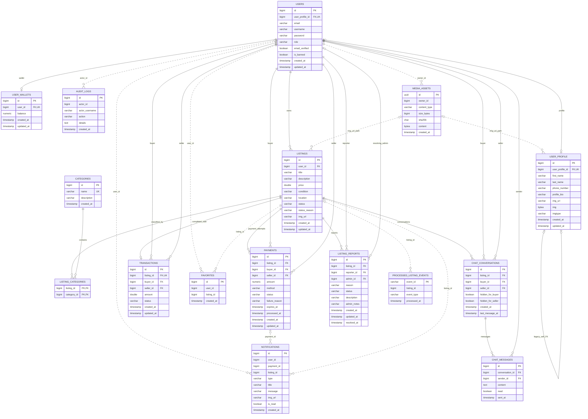

# Used Marketplace ERD

Source: `deploy/ec2/schema.sql` (16 tables). The colored grouping is represented
by the service labels in each entity name.

**Notation**

- Solid relationship: physical PostgreSQL foreign key in the deployed schema.
- Dashed relationship: scalar application reference; no database foreign key.
- `PK`: primary key, `FK`: physical foreign key, `UK`: unique key.

## Service ownership

| Service | Owned tables |
|---|---|
| Accounts | `users`, `user_profile` |
| Marketplace | `listings`, `categories`, `listing_categories`, `payments`, `transactions`, `user_wallets` |
| Favorites | `favorites` |
| Chat | `chat_conversations`, `chat_messages` |
| Moderation | `listing_reports` |
| Notification | `notifications`, `processed_listing_events` |
| Audit | `audit_logs` |
| Media | `media_assets` |

The shared physical schema still contains legacy cross-service foreign keys. New
service code treats cross-service links as scalar IDs and resolves them over the
service contracts, as required by `docs/architecture-decisions.md`.
