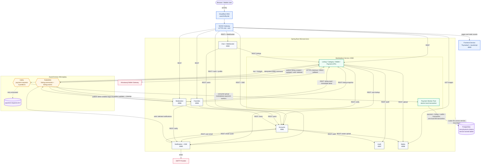

# Used Marketplace — Microservice Architecture

## Communication rules

- **REST** is used for immediate reads and commands. Internal requests carry
  `X-Internal-Token`; browser requests use the `used_auth` HttpOnly JWT cookie
  and `used_csrf` / `X-XSRF-TOKEN` CSRF pair through NGINX.
- **RabbitMQ** propagates listing status changes and runs the moderation delist
  saga with retries and dead-letter queues. It is not used for payment work.
- **Kafka** distributes `payment-requests`, keyed by `listingId`, across the
  `marketplace-payment-workers` consumer group. The worker commits only after
  Marketplace's local payment/listing/wallet/transaction transaction commits.
- Each service owns its tables. References to another service are scalar IDs;
  services do not join across ownership boundaries.
