# Used Marketplace — Presentation Architecture

This is the simplified whiteboard/presentation view. REST calls between services
are intentionally omitted. See `microservices-architecture-detailed.md` for the
engineering-level communication map.

```mermaid
%%{init: {
  "theme": "base",
  "flowchart": { "curve": "basis", "nodeSpacing": 42, "rankSpacing": 55 },
  "themeVariables": {
    "fontFamily": "Arial, sans-serif",
    "fontSize": "18px",
    "primaryTextColor": "#172033",
    "lineColor": "#64748b",
    "clusterBkg": "#ffffff",
    "clusterBorder": "#cbd5e1"
  }
}}%%
flowchart LR
    PEOPLE([Users]) --> DNS[Cloudflare DNS]
    DNS --> EDGE[NGINX<br/>HTTPS Gateway]

    subgraph PLATFORM[Used Marketplace — Spring Boot Microservices]
      direction LR
      FRONTEND[Frontend]
      ACCOUNTS[Accounts]
      CHAT[Chat]
      MARKETPLACE[Marketplace]
      PAYMENTS[Payment Workers<br/><small>inside Marketplace</small>]
      FAVORITES[Favorites]
      NOTIFICATION[Notification]
      MODERATION[Moderation]
      AUDIT[Audit]
      MEDIA[Media]

      FRONTEND ~~~ ACCOUNTS ~~~ CHAT ~~~ MARKETPLACE ~~~ PAYMENTS
      PAYMENTS ~~~ FAVORITES ~~~ NOTIFICATION ~~~ MODERATION ~~~ AUDIT ~~~ MEDIA
    end

    EDGE --> PLATFORM

    subgraph ASYNC[Messaging & Delivery]
      direction LR
      RABBIT{{RabbitMQ<br/>Listing status & delist saga}}
      KAFKA{{Kafka<br/>Payment load distribution}}
      SMTP[SMTP<br/>Email delivery]
    end

    MARKETPLACE --- RABBIT
    MODERATION --- RABBIT
    RABBIT --- FAVORITES
    RABBIT --- NOTIFICATION

    MARKETPLACE --> KAFKA
    KAFKA --> PAYMENTS

    NOTIFICATION --> SMTP

    DATABASE[(PostgreSQL<br/>Service-owned tables)]
    PLATFORM --- DATABASE

    WALLET[Almotawaj<br/>Wallet Gateway]
    MARKETPLACE --- WALLET

    classDef user fill:#eff6ff,stroke:#2563eb,stroke-width:2px,color:#15315b;
    classDef edge fill:#e0f2fe,stroke:#0284c7,stroke-width:2px,color:#0c4a6e;
    classDef service fill:#ffffff,stroke:#475569,stroke-width:2px,color:#172033;
    classDef market fill:#ecfdf5,stroke:#059669,stroke-width:3px,color:#064e3b;
    classDef rabbit fill:#fff7ed,stroke:#ea580c,stroke-width:3px,color:#7c2d12;
    classDef kafka fill:#f5f3ff,stroke:#7c3aed,stroke-width:3px,color:#4c1d95;
    classDef smtp fill:#fefce8,stroke:#ca8a04,stroke-width:2px,color:#713f12;
    classDef data fill:#f8fafc,stroke:#334155,stroke-width:2px,color:#172033;
    classDef external fill:#fff1f2,stroke:#e11d48,stroke-width:2px,color:#881337;

    class PEOPLE user;
    class DNS,EDGE edge;
    class FRONTEND,ACCOUNTS,CHAT,FAVORITES,MEDIA,MODERATION,NOTIFICATION,AUDIT service;
    class MARKETPLACE,PAYMENTS market;
    class RABBIT rabbit;
    class KAFKA kafka;
    class SMTP smtp;
    class DATABASE data;
    class WALLET external;

    style PLATFORM fill:#f8fafc,stroke:#94a3b8,stroke-width:2px
    style ASYNC fill:#ffffff,stroke:#cbd5e1,stroke-width:2px
```

## What to say while presenting

- Browser traffic enters through Cloudflare and the NGINX HTTPS gateway.
- The platform is split into nine independently deployable Spring Boot services.
- Normal request/response communication is intentionally not drawn.
- RabbitMQ distributes listing status changes and coordinates moderation delisting.
- Kafka balances payment jobs across Marketplace payment workers, keyed by listing.
- Notification sends email through SMTP.
- Each service owns its tables; Marketplace completes payment, listing sale,
  wallet credit and transaction records atomically.
